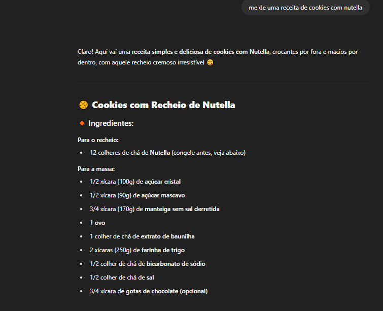
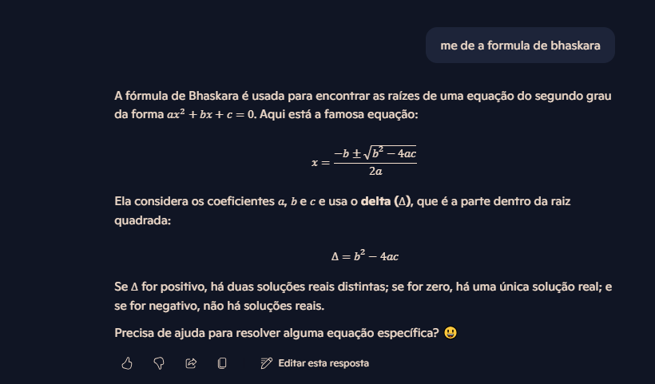
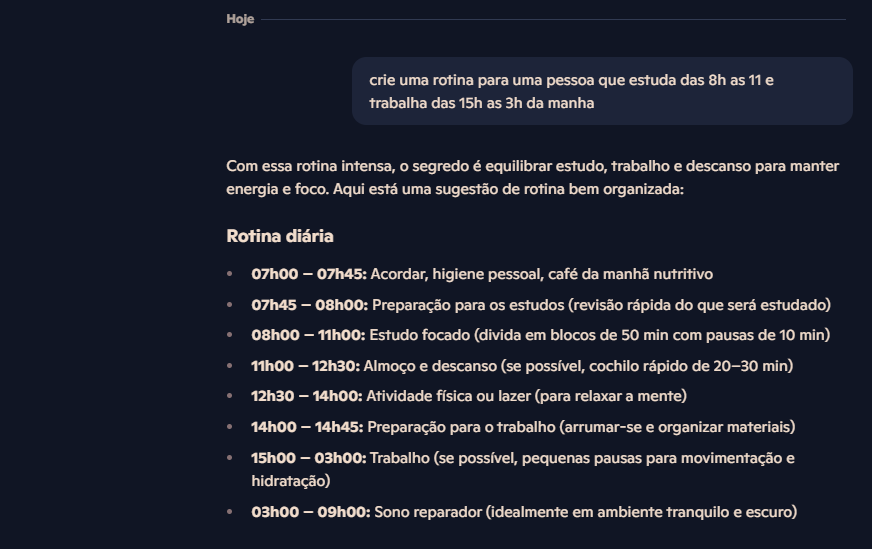

# Engenharia de Prompts

Projeto realizado no curso de Análise e Desenvolvimento de Sistemas.

## O que é um grande modelo de linguagem (LLM)?

É um tipo de algoritmo de inteligência artificial que aplica técnicas de redes neurais com muitos parâmetros para processar e compreender a linguagem humana, usando aprendizado autossupervisionado. Geração de texto, tradução automática, geração de código e chatbots são aplicações dos grandes modelos de linguagem.

## O que significa a sigla GPT?

**Generative Pre-trained Transformer.**

- **Generative:** o modelo gera conteúdo: textos, respostas, histórias, códigos etc.
- **Pre-trained:** ele é pré-treinado em uma enorme quantidade de dados da internet antes de ser ajustado para tarefas específicas.
- **Transformer:** é o tipo de arquitetura de rede neural usada, muito eficiente para entender e gerar linguagem natural.

## O que é Engenharia de Prompts?

A engenharia de prompts é o processo de escrever prompts, ou comandos, para um modelo de inteligência artificial baseado em linguagem, como o ChatGPT, da OpenAI. Essa disciplina foca na formulação de comandos adequados para otimizar as respostas e a interação com o modelo. Em outras palavras, gerar resultados relevantes e úteis para uma questão.

## Por que Engenharia de Prompts é importante para desenvolvedores de sistemas?

Com um prompt bem feito, a inteligência artificial entende melhor o que a pessoa quer e formula respostas melhores. Para quem desenvolve sistemas, isso economiza tempo e ajuda no desenvolvimento.

## Quais são os princípios fundamentais da construção de prompts?

Saber perguntar, com objetividade e clareza, para que a IA saiba responder; explicar como deseja a resposta; e ir refinando o prompt até que fique da forma desejada.

## Principais ferramentas de IA generativa para desenvolvimento de sistemas

- **GitHub Copilot:** ajuda a gerar código e funciona como um copiloto para o desenvolvedor.
- **ChatGPT:** pode identificar erros no código e ajudar a desenvolvê-lo.

## Técnicas de engenharia de prompt

### 1. Zero-shot

O modelo executa a tarefa sem receber nenhum exemplo.

### 2. Few-shot

O modelo recebe alguns exemplos de entrada e saída antes da pergunta, e segue o mesmo padrão na resposta.

> **Entrada:** me dê a fórmula de Bhaskara
> **Saída:** a fórmula de Bhaskara é usada para encontrar as raízes de uma equação do segundo grau, do tipo ax² + bx + c = 0.
>
> **Entrada:** como funciona a fórmula de Bhaskara?
> **Saída:** primeiro calcula-se Δ = b² − 4ac; depois, x = (−b ± √Δ) / 2a.

### 3. One-shot

O modelo recebe um único exemplo de como a resposta deve ser. Usei essa técnica porque já dei a ele o exemplo do formato que eu queria.

> crie uma rotina para uma pessoa que estuda das 8h às 11h e trabalha das 15h às 3h da manhã

Com apenas um exemplo, o modelo já forneceu a rotina apropriada.

